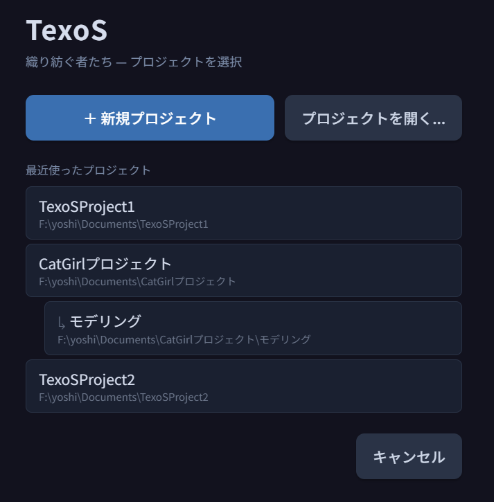
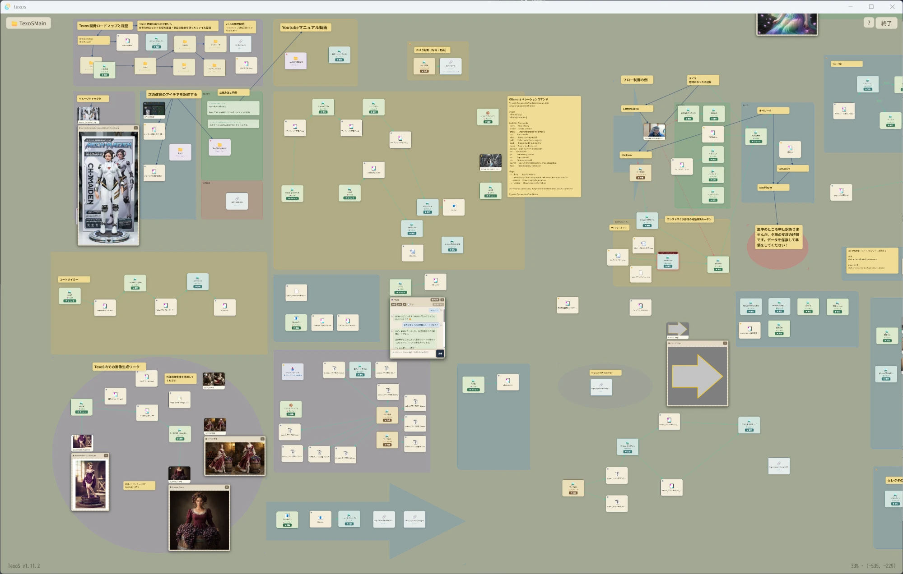
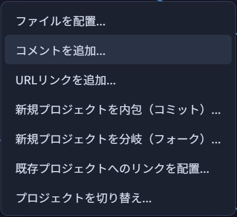
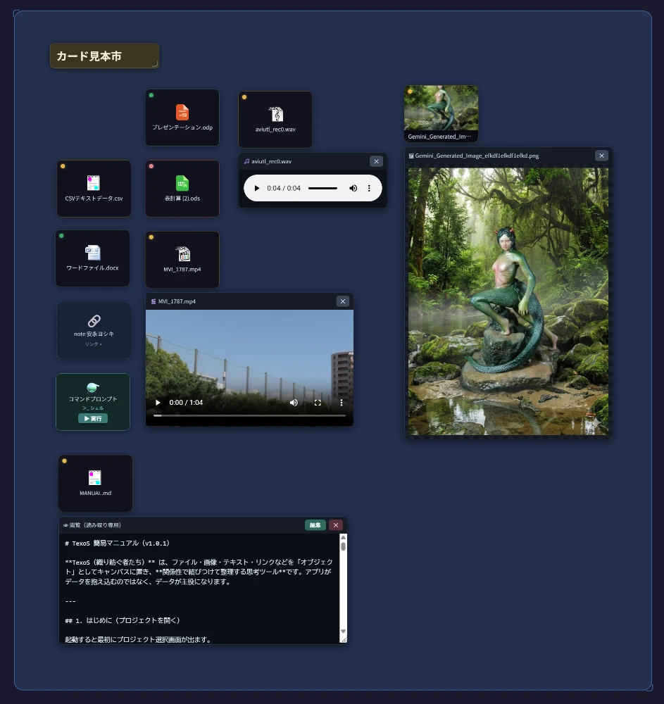
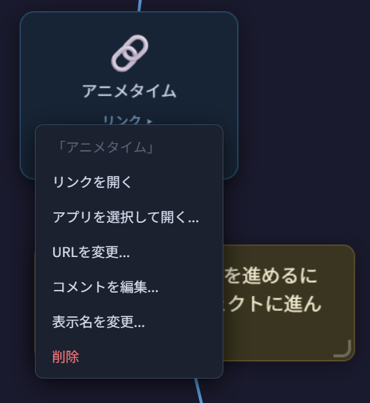

# TexoS 簡易マニュアル（v1.0.1）

**TexoS（織り紡ぐ者たち）** は、ファイル・画像・テキスト・リンクなどを「オブジェクト」としてキャンバスに置き、**関係性で結びつけて整理する思考ツール**です。アプリがデータを抱え込むのではなく、データが主役になります。

---

## 1. はじめに（プロジェクトを開く）

起動すると最初にプロジェクト選択画面が出ます。

- **＋ 新規プロジェクト** … 専用フォルダを選んで新しいプロジェクトを作成
- **プロジェクトを開く…** … 既存のTexoSプロジェクトフォルダを開く
- **最近使ったプロジェクト** … 一覧から選択（サブプロジェクトはインデント表示）

> プロジェクトは「1つのフォルダ」に自己完結します。フォルダごとコピーすれば別PCにも持ち運べます。

---

## 2. 全体像

キャンバス上にオブジェクト（カード）を置き、矢印で関係を結び、付箋でメモを添えます。

**キャンバス操作**

| 操作 | 方法 |
|---|---|
| 移動（パン） | `Shift + ドラッグ`（空き領域）または マウス中ボタンドラッグ |
| 拡大・縮小 | マウスホイール |
| カードを選ぶ | カードをクリック（そのカードだけ選択） |
| 追加で選ぶ | `Ctrl + クリック`（選択をトグル） |
| 範囲で選ぶ | 空き領域をドラッグ（`Ctrl + ドラッグ` で範囲トグル） |
| カードを動かす | カードをドラッグ（複数選択ならまとめて移動） |
| 1枚だけ動かす | `Shift + ドラッグ`（複数選択中でも単体移動） |
| 選択を解除 | 空き領域をクリック、または `Esc` |

操作の覚え方は **LMB＝実行/選択・移動／Shift＝移動／Ctrl＝選択** の3分類です（詳細は
`docs/マウス挙動_ショートカット.txt`）。図形も同じで、`Ctrl+クリック` で複数選択、
`Shift+ドラッグ` で図形だけ移動します。

位置・倍率・開いた状態はプロジェクトごとに自動保存され、次回もそのまま復元されます。

---

## 3. ファイルを取り込む

- **ドラッグ＆ドロップ**：ファイルをウィンドウに落とす
- または空き領域を右クリック →「ファイルを配置…」

取り込んだ時点ではオリジナルは**そのまま（不変）**で、TexoSは参照（仮身）として扱います。

---

## 4. カードの見方とキャンバス内で開く

### 左上の色ドット＝状態

| ドット | 意味 |
|---|---|
| ⚪ 灰（中空） | **仮身**：参照のみ。まだ編集していない |
| 🟢 緑 | **実身**：プロジェクトに取り込み済み（編集可能） |
| 🟠 琥珀 | コミット後に**編集された**（または今セッションで開いた） |

### ダブルクリックで開く（種類ごとに最適表示）

- **画像** → キャンバス上で全体プレビュー
- **音声** → カード下にプレイヤー（再生）
- **テキスト** → カード下に編集パネル（その場で編集・保存）
- その他 → 既定アプリで開く

展開したパネルはカードと一体で動き、**✕** または **Esc** で閉じます。

### 右の青い丸＝リンク作成ハンドル

カードにマウスを乗せると右端に青い丸が出ます。そこから**ドラッグして別カードの上で離す**と、矢印（始点→終点）でリンクが張られます。矢印の線をクリックすると削除できます（マウスを乗せると赤くなります）。右クリックで向きを反転できます（フロー矢印はさらに通過条件などの設定）。

---

## 5. 右クリックでできること

### オブジェクトの上で右クリック
- **既定のアプリで開く／編集** … 関連付けされたアプリで開く
- **アプリを選択して開く…** … 「プログラムから開く」ダイアログ
- **キャンバスで編集／プレビュー** … その場で開く
- **一時的に閲覧** … 使い捨てコピーで安全に閲覧（元は無傷）
- **元のファイルを呼ぶ（仮身を複製）** … 同じ実体への参照をもう1枚
- **表示名を変更／削除**

### 空き領域で右クリック
- ファイルを配置／コメントを追加／URLリンクを追加
- 新規プロジェクトを内包・分岐／既存プロジェクトへのリンク／プロジェクト切り替え

---

## 6. コメント（付箋）

空き領域を右クリック →「コメントを追加…」で付箋を置けます。

- ダブルクリックで編集（`Ctrl+Enter` で確定）
- 右下グリップで**幅変更**、右クリックで**見出し／本文／太字**の切り替え

タイトルやワークフローの説明に使います。

---

## 7. URLリンク

空き領域を右クリック →「URLリンクを追加…」で、Webリンクをカードとして置けます。

- **ダブルクリック**で既定ブラウザを開く
- 右クリック →「アプリを選択して開く…」でブラウザを選択
- 「コメントを編集…」で説明を添える（プレビューの代わり）

---

## 8. プロジェクトの入れ子と行き来

- **内包（コミット）** … 現プロジェクト内に子プロジェクトを作る
- **分岐（フォーク）** … 同じ階層に独立したプロジェクトを作る
- どちらも紫の📁カードとして置かれ、**ダブルクリックでそのプロジェクトへ移動**

左上の `📁 プロジェクト名` をクリックすると切り替え画面に戻れます。

---

## 9. 保存とコミットの考え方

- 配置・移動・リンク・リネームなどは**自動保存**されます
- 「編集」を選ぶと、不変のオリジナルを**プロジェクトフォルダに実ファイルとしてコピー（コミット）**し、それ以降は編集可能になります
- 編集をやり直したいときは、右クリック →「編集を破棄して再コミット」で元に戻せます

> オリジナルは常に保護され、編集は「コピーを所有してから」行う ── これがTexoSの基本思想です。

---

*TexoS v1.0.1 ― 織り紡ぐ者たち*
